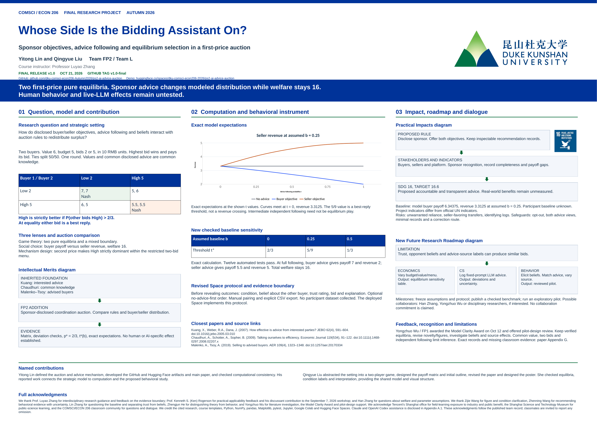

[Download the final A0 poster PDF](poster/final-poster.pdf)

# Whose Side Is the Bidding Assistant On?

**AI Alignment, Human Trust, and Equilibrium Selection in a First-Price Auction**

COMSCI/ECON 206 Computational Microeconomics · Final Project · Team FP2 / Team L ·
Yitong Lin and Qingyue Liu · Course instructor: Professor Luyao Zhang ·
Release: `v1.0-final` (October 21, 2026)

**Research question.** How do disclosed sponsor objectives, advice following and beliefs
interact with auction rules to redistribute surplus?

## The game

Two buyers bid for one second-hand item worth 6 to each (units of 10 RMB). Each has a budget
of 5 and simultaneously bids Low 2 or High 5. The higher bid wins and pays its own bid; ties
split with probability 1/2; play stops after one allocation. Before bidding, buyers may see
deterministic advice whose sponsor is disclosed: none, the buyer, or the seller.

| Buyer 1 / Buyer 2 | Low 2 | High 5 |
|---|---|---|
| **Low 2** | (7, 7) | (5, 6) |
| **High 5** | (6, 5) | (5.5, 5.5) |

## Main results (exact model calculations)

| Fact | Value |
|---|---|
| Pure Nash equilibria (first price) | (Low, Low) and (High, High), plus a symmetric mixed equilibrium |
| High is the better reply when P(other bids High) exceeds | p* = 2/3 |
| Buyer-objective / seller-objective advice | Low / High |
| Advice-following threshold t\*(b) = (2/3 − b)/(1 − b) | 2/3, 5/9, 1/3 at assumed b = 0, 0.25, 0.5 |
| Buyer payoff / seller revenue, no advice (b = 0.25) | 6.344 / 3.312 |
| Buyer payoff / seller revenue at t = 1: buyer / seller advice | 7.0 / 2.0 and 5.5 / 5.0 |
| Total welfare, every profile | 16 (advice only redistributes) |
| Second-price comparison | High strictly dominant; unique equilibrium (High, High) |

`t` is an exogenous advice-following probability and `b` an assumed baseline High share.
Neither is a measured trust score or an empirical estimate. No participant data or
live-LLM results are reported; classroom play is exploratory evidence only.

## Reproduce

```bash
python -m pip install -r requirements.txt
python -m pytest -q          # 12 tests: 8 baseline + 4 sensitivity checks
python run_all.py            # writes outputs/ and figures/
python final_sensitivity.py  # writes outputs/final_baseline_sensitivity.{csv,json,md}
```

Colab: [notebooks/ps2_analysis.ipynb](https://colab.research.google.com/github/dku-comsci-econ206-Autumn2026/ps2-ai-advice-auction/blob/main/notebooks/ps2_analysis.ipynb), Run all.
Exact package versions: `requirements-verified.txt`. The Monte Carlo check uses seed 42 and 10,000 pairs.

## Repository map

| Path | Content |
|---|---|
| `src/auction.py` | Game primitives, payoffs, equilibria, advice rule, following model |
| `tests/` | Automated checks of every reported fact and threshold |
| `run_all.py`, `final_sensitivity.py` | Regenerate all outputs and the figure |
| `notebooks/ps2_analysis.ipynb` | Narrative walk-through with outputs |
| `advice/prompts.md` | Planned protocol for checking live-LLM advice |
| `outputs/`, `figures/` | Generated results |
| `poster/` | Final A0 poster (PNG preview and PDF) |

## Interactive demo

Hugging Face Space: https://huggingface.co/spaces/dku-comsci-econ206-2026/ps2-ai-advice-auction —
three rounds (no advice / buyer objective / seller objective) with a pre-bid belief about the
other buyer (0–100), a trust rating, a bid and a pre-outcome explanation; optional
no-advice-first order; manual partner pairing; CSV export only on explicit request.
Nothing is stored server-side.

## Limits

Common known value, two bid levels, one-shot play, independent following, an assumed baseline
and a deterministic adviser. Adding a feasible bid of 3 breaks the (Low, Low) equilibrium, so
results are menu dependent. No AI-specific, trust-mediated or population effect is claimed.

## Links

- Final paper and A0 poster: submitted on Canvas; poster in `poster/`
- Final Ed record: https://edstem.org/us/courses/102917/discussion/8391519?comment=19481485

License: MIT. AI assistance (Claude, OpenAI Codex) is disclosed in the paper's Appendix A.1.
